# Traffic Density and Congestion Estimation from Single Images

**Epoch Zero 2026 · Computer Vision track · "Pixels to Measurements"**

Author: Pradeep Kumawat · Date: 25 November 2026

Every number in this report comes from the notebook runs (`outputs/`), not typed by hand.

## Summary

On 300 held-out test images the fine-tuned **YOLO26s** detector counts vehicles with a mean absolute error of **1.8 vehicles per image** (19 %), against 3.2 for zero-shot Grounding DINO and 8.2 for the classical OpenCV baseline; class-aware mAP@0.5 is 0.825 vs 0.519. On 118 openly licensed Wikimedia Commons photos from 10 places (hand-held, ground-level, never used for training), the fine-tuned model's congestion level matches a manual label on 64 % of photos (macro-F1 0.609; Grounding DINO 0.569, classical 0.198, always-heavy baseline 0.230).

## 1. Problem

Traffic police, city planners and commuters in Indian cities often have only a **single image** of a
road: a CCTV still, a photo from a foot over-bridge, a frame shared on social media. The question they
ask is quantitative: *how many vehicles are there, of what kind, how much of the road do they occupy,
and is this road jammed?* Indian traffic is heterogeneous: two-wheelers and auto-rickshaws dominate,
and they occupy far less road than a bus, so a plain vehicle count is a poor measure of congestion.

This project turns one image into actionable measurements:

| measurement | definition |
|---|---|
| vehicles per class | number of detected `car`, `two_wheeler`, `auto_rickshaw`, `bus`, `truck` |
| total vehicles | sum over classes |
| vehicle-type distribution | share of each class among all vehicles |
| PCU-weighted count | sum of count × passenger-car-unit factor (Section 3.3) |
| road occupancy | fraction of the road region of interest (ROI) covered by the union of vehicle boxes |
| congestion score / level | score in [0, 1] from PCU and occupancy; levels free / moderate / heavy |

Scope: single still images. Speed, tracking and video are out of scope (Section 7).

## 2. Dataset

### 2.1 Sources

1. **UVH-26** (AIM @ IISc, 2025), <https://huggingface.co/datasets/iisc-aim/UVH-26>, licence
   **CC BY 4.0**. 26,646 frames (1920×1080) from about 2,800 Bengaluru "Safe City" traffic cameras
   with boxes for 14 Indian vehicle classes, crowd-annotated by 565 students; faces and plates masked.
   We use the **STAPLE** consensus labels and a random subset of **3,200 frames** (seed 42).
2. **Wikimedia Commons** (external test): 118 openly licensed photos of Indian roads from
   10 places, collected through the Wikimedia API from the category *Traffic congestion in India*
   and ordinary street/road categories, screened by eye, and labelled with a congestion level only
   (Section 4.2). Author, licence and link of every file: `data/own_photos/commons_sources.csv`.

Full details, licences and the conversion are in `data/SOURCES.md`.

### 2.2 Size

| split   |   images |   vehicles (boxes) |   car |   two_wheeler |   auto_rickshaw |   bus |   truck |
|:--------|---------:|-------------------:|------:|--------------:|----------------:|------:|--------:|
| train   |     2241 |              29654 |  6883 |         13763 |            4622 |  1076 |    3310 |
| val     |      480 |               5859 |  1432 |          2759 |             841 |   191 |     636 |
| test    |      300 |               4027 |   923 |          1841 |             637 |   170 |     456 |

UVH-26 frames downloaded: 3200; grouped into 1956 pseudo-cameras (pHash distance ≤ 12). Automated leakage check: **PASS**. Label sanity problems: 0. Boxes smaller than 32 px: 1.3 %.

The box-annotated test set is made of held-out UVH-26 pseudo-cameras. The Wikimedia Commons photos are a separate external test with congestion-level labels only (Section 4.2).

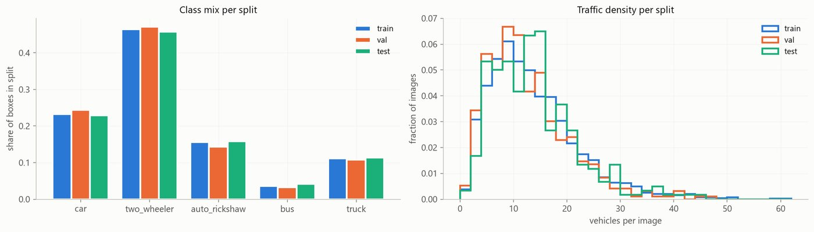

### 2.3 Annotation

* **UVH-26:** boxes come from the dataset (model pre-annotation corrected by several students per
  image, merged with STAPLE). Its 14 classes were mapped to ours: hatchback, sedan, SUV, MUV, van →
  `car`; two-wheeler, bicycle → `two_wheeler`; three-wheeler → `auto_rickshaw`; bus, mini-bus,
  tempo-traveller → `bus`; truck, LCV → `truck`; "others" dropped.
* **Wikimedia Commons photos:** each photo has one congestion level, free / moderate / heavy, judged
  by eye from the road area **before** any model output was seen (`scripts/label_congestion.py --split
  commons`, `data/own_photos/congestion_labels.csv`). Box annotation of these crowded street photos was
  not attempted: distant vehicles cannot be classified reliably, so box-level metrics stay on UVH-26.
* **Collection checks:** non-road images and near-identical burst shots were removed by inspection, and
  every photo was compared with all train and val images: no near-duplicate (pHash ≤ 8) and no shared
  camera view (CNN scene similarity ≥ 0.70).

### 2.4 A split without leakage

Neighbouring frames of the same camera are nearly identical, so a random per-image split would leak.
UVH-26's public release has no camera ids, so frames were grouped into **pseudo-cameras**: two frames
are linked when the Hamming distance between their 64-bit perceptual hashes is small (same static
background), and connected components form the groups. Whole groups were assigned to train / val /
test (70 / 15 / 15 %, seed 42), so the test set contains only cameras never seen in training. An automated check
(`scripts/check_leakage.py`) verifies that no exact duplicate, no near-duplicate (pHash ≤ 8) and no
group crosses splits.

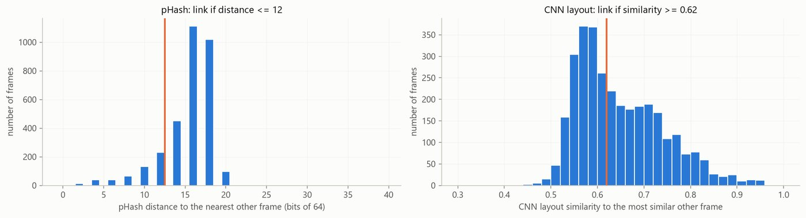

## 3. Method

### 3.1 Pipeline

```
image ─► detector ─► boxes + classes ─► keep boxes in road ROI ─► counts per class, distribution
                                                         │
                                                         ├─► PCU-weighted count
                                                         └─► occupancy (union of boxes / ROI area)
                                         score = α·min(1, PCU/PCU_sat) + (1−α)·min(1, occupancy/occ_sat)
                                         level = free / moderate / heavy  (thresholds t1 < t2)
```

### 3.2 Detector: model selection and fine-tuning

Two COCO-pretrained Ultralytics detectors of the *small* size that fit a 4 GB laptop GPU, YOLO11s
(2024) and YOLO26s (2026), were compared with an identical short fine-tune (**stage 1**: 8 epochs on
the same 50 % of the training images, image size 960, batch 4 with gradient accumulation to a nominal
batch of 64, seed 42). The model with the higher **validation** mAP@0.5:0.95 won. In **stage 2** the
winner continued from its stage-1 checkpoint on **all** training images for up to 10 epochs with
early stopping on validation (`notebooks/02_train.ipynb`). Two short stages were used instead of one
long run to keep the laptop GPU's load and temperature manageable.

| model   |   params (M) |   GFLOPs @640 |   val mAP50 |   val mAP50-95 |   train min/epoch |   peak VRAM (GB) |   inference ms/img |
|:--------|-------------:|--------------:|------------:|---------------:|------------------:|-----------------:|-------------------:|
| yolo11s |         9.46 |          21.8 |      0.8244 |         0.6678 |              1.33 |             2.42 |               13.1 |
| yolo26s |        10.01 |          23.1 |      0.8476 |         0.6949 |              1.32 |             3.17 |               13.4 |

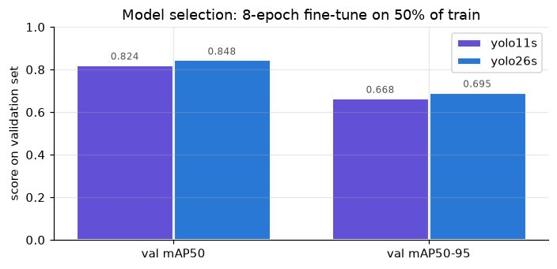

- Base model: `yolo26s.pt` (COCO-pretrained), saved as `weights/yolo26s_traffic_best.pt`
- Training: stage 1 = selection run (8 epochs on 50% of train, from COCO weights); stage 2 = this run on all training images
- Image size 960, batch 4, stage 2 up to 10 epochs with early stopping on validation, seed 42, on NVIDIA GeForce RTX 3050 Laptop GPU
- Training images 2241, validation images 480
- Stage-2 training time 23.4 min, peak GPU memory 3.1 GB
- Epochs run: 10; best epoch 10 with validation mAP@0.5 0.872 and mAP@0.5:0.95 0.730

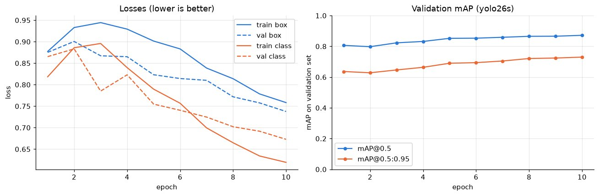

### 3.3 From boxes to measurements

* **ROI.** By default the whole frame; a polygon per image or location can be given in
  `data/rois.json`. A box counts if its bottom-centre (ground contact point) lies in the ROI.
* **PCU weights** from IRC:106-1990 *Guidelines for Capacity of Urban Roads in Plain Areas*, Table 1
  ("5 % composition" column): two-wheeler 0.5, car 1.0, auto-rickshaw 1.2, truck or bus 2.2
  (LCV 1.4 merged into truck, bicycle 0.4 merged into two-wheeler, so these two are approximations).
  At ≥ 10 % share the code lists 0.75 / 1.0 / 2.0 / 3.7; the 5 % column is used throughout.
* **Occupancy** = area of the *union* of vehicle boxes inside the ROI ÷ ROI area (computed on a raster,
  so overlapping boxes are counted once). Boxes over-estimate the vehicle footprint, more for
  two-wheelers seen from the side.
* **Score** = α·min(1, PCU / PCU_sat) + (1 − α)·min(1, occupancy / occ_sat), α = 0.5.
  PCU_sat and occ_sat are the 95th percentiles of the ground truth on the **validation** set.
* **Levels:** free if score < t1, moderate if t1 ≤ score < t2, heavy otherwise. t1, t2 are tuned on
  the **validation** set against manual labels if available, otherwise set at the tertiles of the
  validation ground-truth score (documented fallback).

Values chosen on the validation set:

- Counting confidence threshold: fine-tuned YOLO **0.275**, Grounding DINO **0.325**
- Classical parameters: `{"work_width": 960, "canny_low": 30, "canny_high": 150, "kernel": 3, "dilate_iter": 1, "min_area": 0.0005, "max_area": 0.15, "min_aspect": 0.25, "max_aspect": 4.0, "min_fill": 0.3}`
- Saturation values: PCU_SAT = **24.685** PCU, OCC_SAT = **0.5343** (95th percentile of validation ground truth)
- Level thresholds (t1, t2): fine-tuned YOLO (0.3063, 0.5103), Grounding DINO (0.3063, 0.5103), classical (0.3063, 0.5103), ground-truth boxes (0.3063, 0.5103)
- Threshold source: tertiles of the validation ground-truth score (250 validation images used for tuning)

### 3.4 Baselines

* **Classical (no learning, class-agnostic):** grey → CLAHE → Gaussian blur → Canny edges → dilation
  and closing so the edges of one vehicle merge into a blob → external contours → filter by area
  (fraction of image), aspect ratio and fill ratio → boxes → NMS. Four parameters (Canny low
  threshold, kernel size, dilation iterations, minimum blob area) were grid-searched (36 combinations)
  on the validation set for the lowest count error. Every blob counts as one
  car-equivalent (1 PCU) because the method has no classes.
* **Grounding DINO, zero-shot** (`IDEA-Research/grounding-dino-tiny`, Hugging Face transformers):
  text prompt "car. motorcycle. scooter. bicycle. auto rickshaw. bus. truck.". Each predicted box gets
  the class of its best-matching phrase; duplicates are removed by class-agnostic NMS. No training on
  our data; only the counting confidence threshold is chosen on validation, as for YOLO.

### 3.5 Evaluation protocol

All three methods run on the **same held-out test set**, never used for training or tuning. Detection
metrics: COCO-style mAP@0.5 and mAP@0.5:0.95 (101-point interpolation), class-aware for the two
learned detectors and class-agnostic ("vehicle") for all three; precision and recall at each method's
counting threshold. Measurement errors in **real units**: count MAE (vehicles per image), signed bias,
mean % count error per image, per-class count MAE, L1 error of the type distribution (0–2), congestion
score MAE, and agreement of the congestion level with the level computed from the ground-truth boxes.
On the external Wikimedia Commons photos the congestion level is compared with the manual labels
(accuracy, macro-F1, recall per level, and a majority-class baseline), using the thresholds tuned on
UVH-26 validation without any re-tuning.

## 4. Results

### 4.1 Held-out UVH-26 test set

Held-out test set: **300 images, 4027 vehicles** (pseudo-cameras never used for training or tuning).

| test set: 300 images, 4027 vehicles    | Classical OpenCV                          | Grounding DINO zero-shot                  | YOLO26s fine-tuned                        |
|:---------------------------------------|:------------------------------------------|:------------------------------------------|:------------------------------------------|
| mAP@0.5 (5 classes)                    | n/a                                       | 0.519                                     | 0.825                                     |
| mAP@0.5:0.95 (5 classes)               | n/a                                       | 0.349                                     | 0.690                                     |
| mAP@0.5 (class-agnostic)               | 0.003                                     | 0.726                                     | 0.890                                     |
| mAP@0.5:0.95 (class-agnostic)          | 0.002                                     | 0.394                                     | 0.729                                     |
| Precision (vehicle, IoU 0.5)           | 0.040                                     | 0.735                                     | 0.858                                     |
| Recall (vehicle, IoU 0.5)              | 0.022                                     | 0.666                                     | 0.832                                     |
| Count MAE (vehicles / image)           | 8.25                                      | 3.21                                      | 1.81                                      |
| Count bias (vehicles / image)          | -5.90                                     | -1.25                                     | -0.41                                     |
| Count RMSE (vehicles / image)          | 11.15                                     | 4.56                                      | 2.52                                      |
| Mean % count error per image           | 71.5 %                                    | 28.4 %                                    | 18.8 %                                    |
| MAE car (vehicles / image)             | n/a                                       | 1.22                                      | 0.75                                      |
| MAE two_wheeler (vehicles / image)     | n/a                                       | 1.71                                      | 1.04                                      |
| MAE auto_rickshaw (vehicles / image)   | n/a                                       | 1.74                                      | 0.39                                      |
| MAE bus (vehicles / image)             | n/a                                       | 0.45                                      | 0.21                                      |
| MAE truck (vehicles / image)           | n/a                                       | 0.88                                      | 0.65                                      |
| Type-distribution L1 error (0-2)       | n/a                                       | 0.438                                     | 0.237                                     |
| Congestion score MAE vs GT boxes (0-1) | 0.327                                     | 0.091                                     | 0.061                                     |
| Level agreement with GT-box level      | 0.257                                     | 0.733                                     | 0.817                                     |
| Seconds / image (this machine)         | 0.023                                     | 0.591                                     | 0.044                                     |

**Errors in real units:**

- **Classical OpenCV**: off by **8.2 vehicles per image** on average (72 % of the true count; mean signed error -5.9); congestion level agrees with the ground-truth-box level on 26 % of images
- **Grounding DINO zero-shot**: off by **3.2 vehicles per image** on average (28 % of the true count; mean signed error -1.3); congestion level agrees with the ground-truth-box level on 73 % of images
- **YOLO26s fine-tuned**: off by **1.8 vehicles per image** on average (19 % of the true count; mean signed error -0.4); congestion level agrees with the ground-truth-box level on 82 % of images

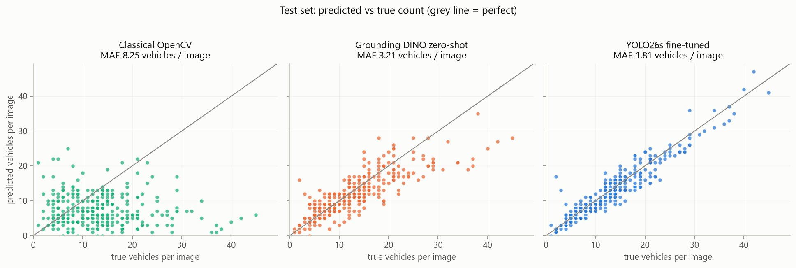

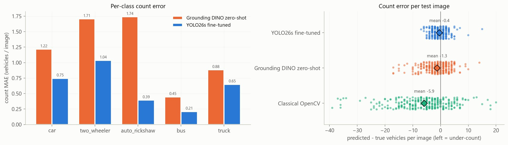

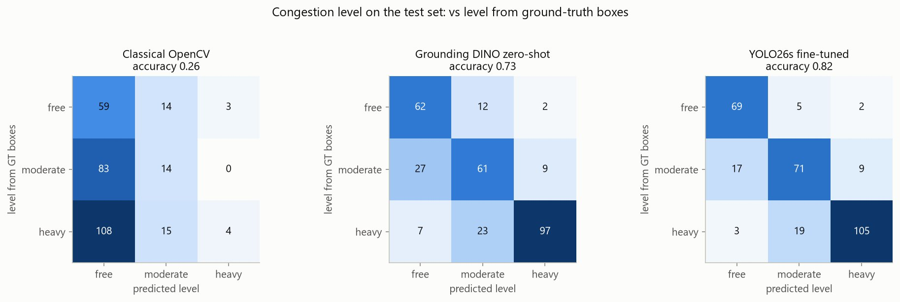

Interpretation: the fine-tuned model is best on every metric. Fine-tuning
taught it Indian classes: its auto-rickshaw count error is 0.39 vehicles per image versus 1.74 for zero-shot
Grounding DINO, which knows "car" and "bus" well but confuses autos and misses vehicles in crowded scenes (it
under-counts by 1.25 vehicles per image on average). The classical edge-and-contour pipeline fails on these
scenes: touching vehicles merge into one blob while road markings and buildings create spurious blobs, so its
boxes almost never match real vehicles (class-agnostic mAP@0.5 0.003) and it under-counts by 5.9 vehicles per
image. The congestion level from the fine-tuned model agrees with the level computed from the ground-truth
boxes on 82 % of test images.

### 4.2 External test: Wikimedia Commons photos

118 photos from 10 places; manual labels: 33 free, 23 moderate,
62 heavy. Same thresholds as on UVH-26 (tuned on UVH-26 validation, no re-tuning).

| method | accuracy | macro-F1 | recall free | recall moderate | recall heavy | median vehicles counted |
|---|---|---|---|---|---|---|
| Classical OpenCV | 0.297 | 0.198 | 1.000 | 0.087 | 0.000 | 2 |
| Grounding DINO zero-shot | 0.636 | 0.569 | 0.545 | 0.304 | 0.806 | 12.5 |
| YOLO26s fine-tuned | 0.644 | 0.609 | 0.636 | 0.478 | 0.710 | 10 |
| baseline: always 'heavy' | 0.525 | 0.230 | 0.000 | 0.000 | 1.000 | – |

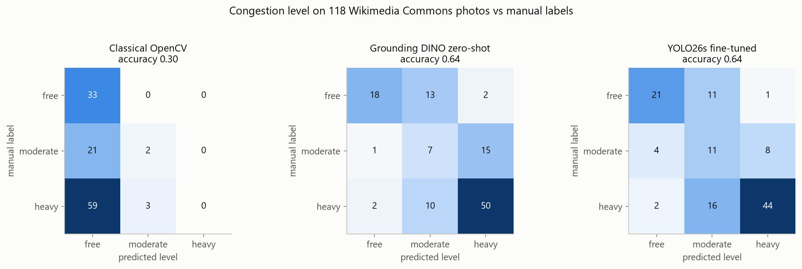

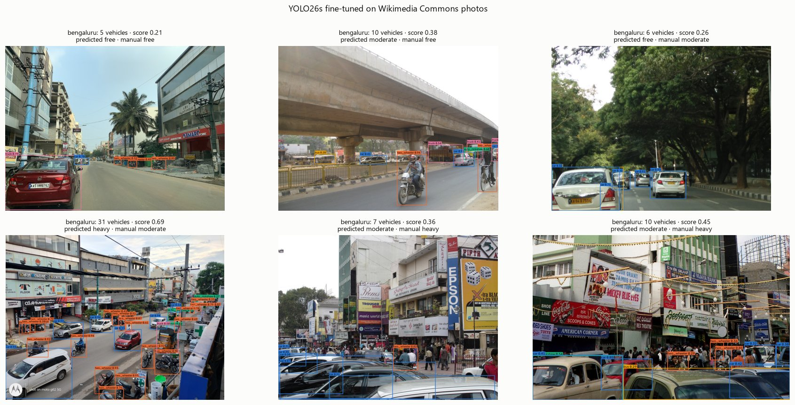

Two photos per manual level; titles give the vehicle count, score, predicted level and manual label.

* **Fine-tuned YOLO is the best method here too**, but the margin is small: accuracy 0.644 and
  macro-F1 0.609, against 0.636 / 0.569 for zero-shot Grounding DINO.
  Both clearly beat the trivial "always heavy" baseline (0.525 accuracy, 0.230 macro-F1).
* **The domain gap is visible.** On UVH-26 test images the fine-tuned model's level agrees with the
  ground-truth-box level on 82 % of images; on these hand-held photos it matches the manual label on
  64 %. Most errors are one level apart. The most common one is a **heavy street scene rated
  moderate** (recall heavy 0.710): in a close-up street photo a jam is a few large cars filling
  the frame, while the road ROI is the whole image (sky and buildings included), so occupancy is diluted and
  the PCU count stays low. CCTV frames, which the thresholds were tuned on, are mostly road.
* **Grounding DINO** detects more vehicles per photo (median 12.5 vs 10)
  and therefore finds heavy scenes more often (recall heavy 0.806), but it pushes many moderate
  scenes to heavy (recall moderate 0.304).
* **The classical pipeline** calls almost everything free (recall free 1.000, recall heavy
  0.000): close vehicles are larger than its maximum blob area and touching vehicles merge,
  so it counts a median of 2 blobs per photo.
* **What would help:** a road polygon per photo (the `roi` argument of `predict`) so occupancy is measured on
  the road only, and level thresholds tuned on a few labelled photos of this kind.

## 5. Example outputs

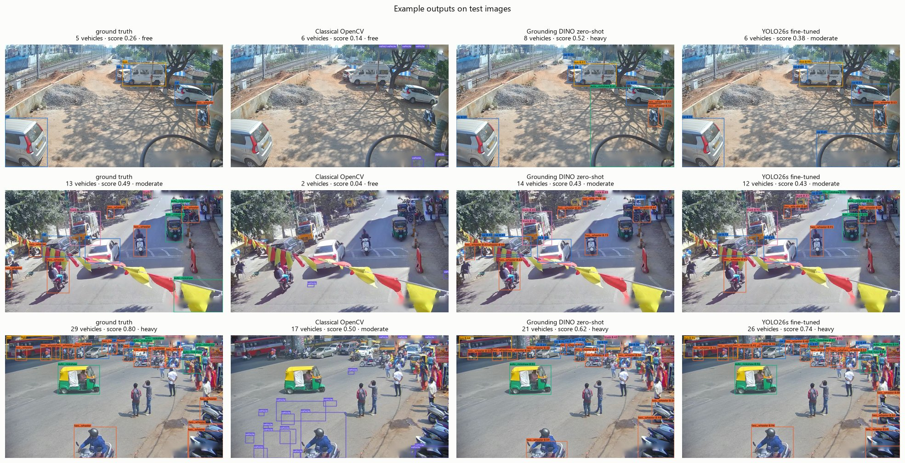

Each row: ground truth, classical, Grounding DINO, fine-tuned model; the title gives the total count,
congestion score and level.

## 6. Failure cases and error analysis

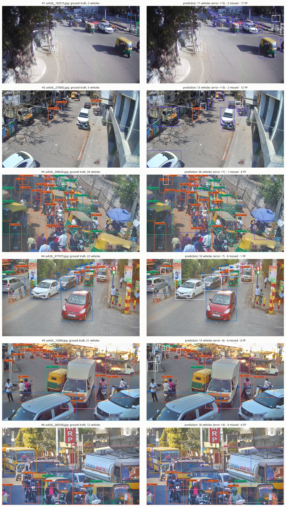

|   # | image             |   GT |   pred |   error |   missed (FN) |   false pos. |   matched, wrong class |   GT boxes < 32x32 px |   mean brightness (0-255) |
|----:|:------------------|-----:|-------:|--------:|--------------:|-------------:|-----------------------:|----------------------:|--------------------------:|
|   1 | uvh26__192515.jpg |    2 |     17 |      15 |             2 |           17 |                      0 |                     0 |                     122.6 |
|   2 | uvh26__270002.jpg |    3 |     13 |      10 |             2 |           12 |                      0 |                     0 |                     134.2 |
|   3 | uvh26__506626.jpg |   29 |     36 |       7 |             1 |            8 |                      3 |                     0 |                     122.1 |
|   4 | uvh26__977075.jpg |   23 |     16 |      -7 |             8 |            1 |                      0 |                     0 |                     142.1 |
|   5 | uvh26__12099.jpg  |   21 |     15 |      -6 |             6 |            0 |                      0 |                     0 |                     129.3 |
|   6 | uvh26__383558.jpg |   12 |     18 |       6 |             0 |            6 |                      1 |                     0 |                     130.7 |

Explanations, from inspecting each image:

1. **uvh26__192515.jpg**: Over-count +15, but mostly an **annotation gap**: the ground truth has only 2 boxes while the image clearly shows a queue of autos, cars and two-wheelers. Most 'false positives' are real vehicles. The count error here measures label quality, not the model.
2. **uvh26__270002.jpg**: Over-count +10, again **incomplete ground truth**: only 3 two-wheelers are labelled, but the parked truck, the white SUV, the car at the bottom-left and the autos in the background are real vehicles that the model finds.
3. **uvh26__506626.jpg**: Over-count +7 in a **very dense, close-up crowd**: riders and pedestrians overlap the two-wheelers, so the model adds duplicate or partial boxes; 3 matched boxes have the wrong class (auto vs two-wheeler under heavy occlusion).
4. **uvh26__977075.jpg**: Under-count −7: **small, distant vehicles** at the back of the queue near the top of the frame, and cars hidden behind other cars, are missed or boxed too loosely (IoU < 0.5).
5. **uvh26__12099.jpg**: Under-count −6: missed **far-away two-wheelers** at the top-left and vehicles cut by the image border; the large cars in front are detected correctly.
6. **uvh26__383558.jpg**: Over-count +6: **large vehicles very close to the camera** (tanker, bus, truck cabin) are partly out of frame and get extra fragment boxes, plus duplicate boxes on two-wheeler riders.

**Common patterns.** (1) Some UVH-26 frames have incomplete labels, which inflates both 'false positives' and the count error. (2) Dense occlusion produces duplicate or mis-classed boxes. (3) Small distant vehicles and objects cut by the frame are missed. Better labels, higher input resolution for far vehicles, and a road ROI that excludes the far background would reduce these errors.

## 7. Limitations

* **Domain:** training data are Bengaluru CCTV frames in daylight (06:00–18:00, February). Night, rain,
  other cities and phone photos at street level are under-represented; the Wikimedia Commons test
  (Section 4.2) measures part of this gap.
* **Boxes, not footprints:** occupancy uses axis-aligned boxes, which overlap in dense scenes and include
  background, so occupancy is over-estimated in perspective views.
* **Perspective:** a single image has no metric scale; far vehicles are small and are missed more
  often, and the same count means different densities for wide and narrow views. A per-camera ROI and
  homography would make occupancy comparable across cameras.
* **PCU weights** are static (IRC:106-1990, 5 % column) while real PCU depends on composition and
  speed; LCVs and bicycles are approximated by merged classes.
* **Congestion labels** of the Commons photos are judgements by eye from a still image; the
  free/moderate/heavy boundary is subjective. Level thresholds are the tertiles of the validation
  ground-truth score, since the validation images have no manual level labels.
* **External test set:** the Commons photos are unbalanced towards heavy traffic (the main source category
  is *Traffic congestion in India*) and have no boxes, so they measure only the final level.
* **Pseudo-camera grouping** may miss the same camera under very different lighting; the
  leakage check reduces but cannot exclude this.
* **Out of scope:** speed, tracking, flow over time. Future work: count over video frames, per-camera
  calibration, night images, segmentation masks (e.g. SAM) for a tighter occupancy estimate.

## 8. How to run the notebook on a new image

1. Open `traffic_flow_main.ipynb`: locally in VS Code with the kernel "Python 3.12 (Epoch_Zero .venv)",
   or in Google Colab (upload the `TrafficProject` folder to Google Drive; the first cell mounts Drive
   and finds the folder; use a GPU runtime if available).
2. *Run All*. The notebook loads the saved weights from `weights/` (it does not retrain), re-creates the
   tuned thresholds and the results, and defines `predict(image_path)` in the last cell.
3. Copy the new image into the project folder, e.g. `my_road.jpg`.
4. In a new cell run `predict("my_road.jpg")`. It shows the image with the detected
   vehicles and returns a dictionary: counts per class, total, type distribution, PCU-weighted count,
   occupancy, congestion score and level.
5. Optional: restrict to the road with `predict(path, roi=[[x1, y1], [x2, y2], ...])`, points as
   fractions of image width and height.

## 9. References

* Sharma, A. et al. *Towards Image Annotations and Accurate Vision Models for Indian Traffic,
  Preliminary Dataset Release, UVH-26-v1.0.* Technical Report, Indian Institute of Science,
  arXiv:2511.02563, 2025. Dataset: <https://huggingface.co/datasets/iisc-aim/UVH-26> (CC BY 4.0).
* Indian Roads Congress. *IRC:106-1990 Guidelines for Capacity of Urban Roads in Plain Areas*, Table 1.
* Liu, S. et al. *Grounding DINO: Marrying DINO with Grounded Pre-Training for Open-Set Object
  Detection.* ECCV 2024. Model: <https://huggingface.co/IDEA-Research/grounding-dino-tiny>.
* Jocher, G. et al. *Ultralytics YOLO* (YOLO11 / YOLO26), <https://github.com/ultralytics/ultralytics>.
* Lin, T.-Y. et al. *Microsoft COCO: Common Objects in Context.* ECCV 2014 (pretraining data, mAP definition).
